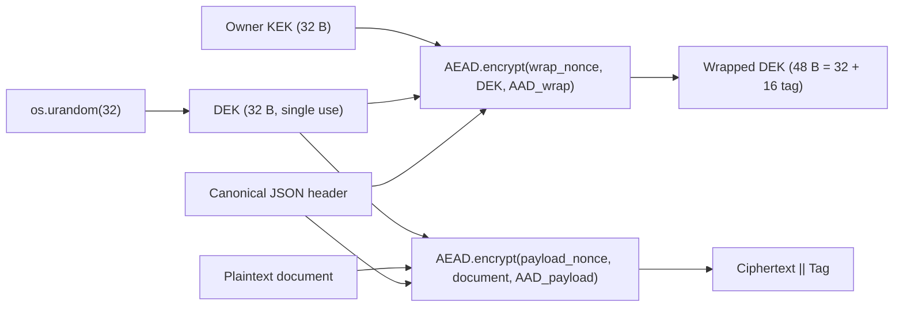
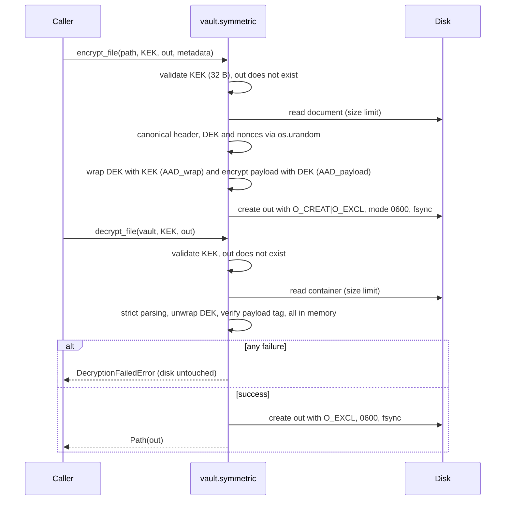
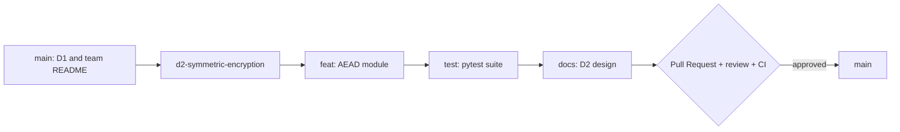

# D2 — Authenticated Symmetric Encryption Module

**Project:** Secure Digital Document Vault
**Module:** [`vault/symmetric.py`](../vault/symmetric.py) · Exceptions: [`vault/exceptions.py`](../vault/exceptions.py) · Tests: [`tests/test_symmetric.py`](../tests/test_symmetric.py)
**Branch:** `d2-symmetric-encryption`

---

## 1. Objective

Guarantee the **confidentiality**, **integrity** and **tamper detection** of a single owner's documents using
authenticated encryption (AEAD) with *envelope encryption*.

> **Security goal.** An attacker who obtains the encrypted container cannot read its contents or modify a single bit
> of the data **or the metadata** without decryption failing immediately, safely, and without emitting any partial
> data.

---

## 2. Design

### 2.1 Primitives and parameters

| Parameter | Value | Comment |
|---|---|---|
| Library | `cryptography >= 44.0.0` (high-level AEAD API) | No hand-implemented primitives |
| AEAD | **AES-256-GCM** (`AESGCM`) | The vault's only algorithm; hardware-accelerated (AES-NI + PCLMULQDQ) |
| User key (KEK) | 256 bits (32 B) | Any other length is rejected, even the 128/192 bits that `AESGCM` would accept |
| Data key (DEK) | 256 bits, **new per file** | `os.urandom(32)` |
| Nonce | 96 bits (12 B) | `os.urandom(12)`; size recommended by NIST SP 800-38D |
| Tag | 128 bits (16 B) | Never truncated |
| Randomness source | OS CSPRNG (`os.urandom` → `getrandom(2)`) | `random` is forbidden; verified by a static (AST) test |

The algorithm name is recorded (and authenticated) in the header. ChaCha20-Poly1305 was evaluated and discarded:
it is not needed, because AES-GCM is hardware-accelerated on almost any PC, and having a single algorithm removes
configuration options that could be misused.

### 2.2 Envelope encryption



Advantages: (1) the KEK only encrypts 32 bytes per file, which keeps its number of uses very low; (2) rotating the
KEK only requires re-wrapping the DEKs, not re-encrypting the documents; (3) every document has an independent key,
so compromising one DEK does not affect the others.

### 2.3 Nonce lifecycle

| Nonce | Key it is used under | Generation | Uniqueness |
|---|---|---|---|
| `payload_nonce` | The file's DEK | `os.urandom(12)` | **Absolute by construction:** the DEK is new and is used for exactly one encryption, so the *(key, nonce)* pair can never repeat. |
| `wrap_nonce` | The owner's KEK | `os.urandom(12)` | Probabilistic: the collision probability after *q* wraps is ≈ *q*² / 2⁹⁷. At the NIST limit (2³² invocations per key with random nonces) the probability is ≤ 2⁻³³. A single owner never gets near that volume. |

Rules applied:

1. Nonces are generated **immediately before** each operation and written into the container; they are never derived
   from time, in-memory counters or seeds.
2. A nonce is never reused: re-encrypting the same file produces a new DEK, nonces, wrapped DEK, ciphertext and tag
   (`TestUniqueness` test).
3. On decryption, the nonces are read from the container and also form part of the payload's AAD.
4. The DEK is discarded (`del`) after use. CPython does not allow memory to be erased with any guarantee (see §3.3).

### 2.4 Container format

Integers are *big-endian*. `N` = header length, `M` = document length (GCM preserves length).

| Offset | Size | Field | Protection |
|---|---|---|---|
| 0 | 4 B | Magic `SDDV` | AAD of both AEADs |
| 4 | 4 B | Header length `N` (`uint32`) | AAD of both AEADs |
| 8 | N B | Canonical JSON header (in clear) | AAD of both AEADs |
| 8+N | 12 B | Wrap nonce | Input of the DEK's AEAD + payload AAD |
| 20+N | 48 B | Wrapped DEK (32 B encrypted + 16 B tag) | Its own tag + payload AAD |
| 68+N | 12 B | Payload nonce | Input of the payload's AEAD + payload AAD |
| 80+N | M B | Ciphertext | Payload tag |
| 80+N+M | 16 B | Tag | — |

Total size = `96 + N + M` bytes.

**Binding (AAD):**

```text
AAD_wrap    = magic ‖ len ‖ header
AAD_payload = magic ‖ len ‖ header ‖ wrap_nonce ‖ wrapped_dek ‖ payload_nonce
```

`AAD_payload` is exactly everything that precedes the ciphertext, so **every byte of the container is covered by at
least one tag**. The test `test_exhaustive_every_bit_of_container_is_authenticated` flips every single bit of a
container and checks that all variants are rejected. In addition, `AAD_wrap` binds the wrapped DEK to *its own*
header: a wrapped DEK (or a header) cannot be transplanted between containers.

### 2.5 Header (authenticated metadata)

Real example (the metadata travels **in clear**; here with `include_filename=True`):

```json
{"alg":"AES-256-GCM","created_at":"2026-10-14T16:32:37Z","filename":"doc.pdf","key_bits":256,"key_wrap":"AES-256-GCM","metadata":{"owner":"alice"},"nonce_bytes":12,"tag_bytes":16,"version":1}
```

| Field | Required | Description |
|---|---|---|
| `version` | Yes | Format version (`1`) |
| `alg` / `key_wrap` | Yes | AEAD of the payload and of the DEK wrap (always `AES-256-GCM`; any other value is rejected) |
| `key_bits`, `nonce_bytes`, `tag_bytes` | Yes | Cryptographic parameters (`256`, `12`, `16`) |
| `created_at` | Yes | ISO-8601 UTC timestamp (`YYYY-MM-DDTHH:MM:SSZ`) |
| `filename` | No | Original name; only stored with `include_filename=True` (disabled by default) |
| `metadata` | No | User-supplied JSON dictionary |

**Canonical serialization:** sorted keys, no whitespace (`separators=(",", ":")`), ASCII only
(`ensure_ascii=True`), no `NaN`/`Infinity`. When encrypting, an exact *round-trip* is also required (rejects tuples,
non-`str` keys and circular references). Maximum size: 64 KiB.

**Strict parsing on decryption** (before authenticating, the header is treated as hostile data): strict ASCII, JSON
with no duplicate keys or non-finite constants, a canonical re-serialization identical byte for byte, exact fields
(no unknown ones), exact types (`True` is not accepted as `1`) and parameters with only the permitted values
(AES-256-GCM, 256 bits, 12 B, 16 B). Even though the raw bytes are already authenticated, this eliminates *parser
differential* attacks and algorithm *downgrade* attacks. The header is only returned to the caller **after** both
tags have been verified.

> [!NOTE]
> The canonicalization is deterministic and strict, inspired by RFC 8785 (JCS), but does not implement it 100%
> (key ordering by *code point* and Python's float formatting). This does not affect security because the exact
> bytes that travel in the container are what gets authenticated.

### 2.6 Flows



### 2.7 Error and disk handling

* **One exception, one message:** any failure when opening a container (wrong key, invalid tag, modified bit in the
  data or metadata, truncation, invalid JSON, unsupported version/algorithm) produces
  `DecryptionFailedError("Decryption failed: the container is invalid, has been tampered with, or the key is incorrect.")`.
* **No chaining:** the exception is raised *outside* the `except` block, so `__cause__` and `__context__` are
  `None`; a traceback does not reveal whether parsing, DEK unwrapping or the payload tag failed.
* **Caller errors** (not attacker-controllable) are descriptive: `InvalidKeyError`, `InvalidMetadataError`,
  `PlaintextTooLargeError` (all `VaultError` + `ValueError`).
* **Verify before writing:** the full decryption happens in memory using the *one-shot* API of `cryptography`,
  which returns no plaintext if the tag does not verify. The output file is created **only after success**.
* **No temporary files or leftovers:** the output is created with `O_CREAT | O_EXCL` (it neither follows nor
  overwrites existing files or *symlinks*), permissions `0600` and `fsync`. If the write fails midway (e.g.
  `ENOSPC`), the partial file is removed before the `OSError` is propagated.
* **Never overwrites** an existing file (`FileExistsError`).
* **Output name chosen by the caller:** the header's `filename` is never used as a path, which prevents
  *path traversal*.

### 2.8 Public API

```python
encrypt_file(file_path: Path, owner_key: bytes, output_path: Path,
             metadata: Optional[dict] = None, *, include_filename=False) -> Path
decrypt_file(vault_file_path: Path, owner_key: bytes, output_path: Path) -> Path

# In-memory variants, reusable by later deliverables
encrypt_bytes(plaintext, owner_key, *, metadata=None, filename=None) -> bytes
decrypt_bytes(container, owner_key) -> DecryptedDocument(plaintext, header)
generate_owner_key() -> bytes   # 32 B from the OS CSPRNG
```

---

## 3. Security rationale

### 3.1 Why AEAD and not "encryption + hash" (e.g. AES-CBC + SHA-256)?

1. **A hash is not an authenticator.** `SHA-256(ciphertext)` uses no key: an attacker modifies the ciphertext and
   recomputes the hash. A **keyed MAC** (HMAC) would be needed, plus a second independent key and a constant-time
   comparison.
2. **Order matters and it is easy to get wrong.** Only *Encrypt-then-MAC* is generically secure. *MAC-then-Encrypt*
   with CBC has produced real *padding oracle* attacks (Vaudenay 2002, Lucky 13, POODLE), which recover the
   plaintext byte by byte from differing errors or timings.
3. **You have to remember to authenticate everything:** the IV, metadata, algorithm and lengths. Leaving the IV or
   the metadata out of the MAC allows manipulation (e.g. altering the first CBC block by modifying the IV).
4. **CBC requires *padding*** and an unpredictable IV; GCM has no padding, which entirely eliminates the class of
   padding oracle attacks.
5. **AEAD is a standard, well-analysed primitive** (IND-CCA2 + INT-CTXT) that delivers confidentiality, integrity
   and **associated data (AAD)** in a single call, with an API that *verifies before returning* the plaintext.
   Fewer moving parts = less implementation-error surface. AES-GCM is also faster than CBC + HMAC on modern
   hardware.

### 3.2 Catastrophic consequences of nonce reuse in GCM

GCM = CTR encryption + a GHASH authenticator with key `H = AES_K(0¹²⁸)`. If two messages are encrypted under the
same key and the same nonce:

1. **Loss of confidentiality:** the CTR *keystream* repeats, so `C₁ ⊕ C₂ = P₁ ⊕ P₂`. Knowing or guessing part of one
   document (PDF headers, templates) reveals the corresponding part of the other.
2. **Total loss of authenticity (*forbidden attack*, Joux 2006; Böck et al. 2016):** the two tags give a polynomial
   system over GF(2¹²⁸) whose root is `H`. Once `H` (and the tag mask) is recovered, the attacker can **forge valid
   tags for arbitrary messages** under that key and nonce, and modify ciphertexts at will without detection.
   Integrity ceases to exist.
3. **Contagion via the KEK:** in our scheme, a `wrap_nonce` collision under the KEK would reveal `DEK₁ ⊕ DEK₂` and
   the wrap's GHASH key, allowing wrapped DEKs to be forged.

**Mitigations in this design:** a new DEK per file (the payload nonce is unique by construction); 96-bit nonces
from the OS CSPRNG; the KEK only wraps 32 B per file, far below the 2³² invocation limit; an automated uniqueness
test over 300 encryptions and a test that verifies that **all** randomness comes from `os.urandom` (exactly
32 + 12 + 12 bytes per file).

### 3.3 Threat model

**Assets:** document contents (confidentiality + integrity) and header metadata (integrity).

**Attacker considered:** controls the storage or channel where the container resides (stolen disk, cloud, backup,
network). They can **read, copy, modify, truncate, extend, reorder and transplant** bytes or entire containers;
they know the format and the code; they can obtain containers of plaintexts of their choosing. They do **not** know
the KEK and do not control the owner's machine.

| Attack | Defense |
|---|---|
| Reading the document | AES-256-GCM with a 256-bit DEK |
| Modifying ciphertext, tag or nonces | Tag failure → `DecryptionFailedError` |
| Modifying metadata (name, date, algorithm, version) | Header bound as AAD to both AEADs |
| Algorithm/parameter *downgrade* | Only one supported algorithm + authenticated parameters |
| Transplanting wrapped DEK / header between containers | `AAD_wrap` and `AAD_payload` |
| Truncating / appending bytes | Authenticated lengths + final tag |
| Error oracle / padding oracle | Single unchained error; AEAD without padding |
| Key brute force | 2²⁵⁶ search space |
| Overwrite / *symlink* on the output path | `O_EXCL`, rejection of existing paths |

**Out of scope in this phase (accepted risks):**

* **Replay / rollback:** an **old but valid** version of a container decrypts correctly; there is no notion of
  freshness. *Future mitigation:* an authenticated manifest with a per-document monotonic version.
* **Substitution of whole documents** of the same owner (swapping `a.vault` for `b.vault`): both are authentic. The
  application can compare the authenticated `filename` with the expected one; a document identifier bound to the
  vault index will be addressed later.
* **Deletion** of containers (availability / DoS).
* **Confidentiality of metadata and size:** the header is in clear and the ciphertext length reveals the exact
  size. The file name is not stored unless `include_filename=True` is enabled; do not put secrets in `metadata`.
* **KEK management:** generation, storage and password-based derivation (Argon2id/scrypt) belong to a later
  deliverable.
* **Compromise of the machine:** malware, debuggers, memory dumps, *swap*, *cold boot* attacks. CPython does not
  guarantee erasure of keys in memory (immutable `bytes` objects).
* **Secure erasure on disk:** when deleting a partial file after an I/O failure, the physical blocks may persist
  (journaling, SSD *wear leveling*). Recommended: full-disk encryption.
* **Local timing/cache side channels** (we rely on OpenSSL's constant-time implementation). Failure timing
  distinguishes "fails in the wrap" from "fails in the payload", but that gives no advantage: the attacker already
  knows which bytes they altered and GCM has no padding to leak.
* **Key commitment:** GCM is not *key-committing* (*invisible salamanders*-type attacks). With a single owner and a
  single KEK the risk is low; it will become relevant when there are multiple recipients.
* **Multi-user, signatures and non-repudiation:** outside the scope of D2.

---

## 4. Test traceability

| Requirement | Tests (`tests/test_symmetric.py`) |
|---|---|
| 1. Full byte-for-byte cycle | `TestRoundTrip::test_file_roundtrip_is_byte_identical` (0 B to 1 MiB), layout, canonical header, Unicode |
| 2. Wrong key without a file | `TestWrongKey` (random key, 1-bit-off key, invalid lengths/types) |
| 3. Tampered ciphertext | `TestCiphertextTampering` (random bit ×25, every region, **every bit of the container**, truncation, extension, transplants) |
| 4. Tampered metadata | `TestMetadataTampering` (13 semantic mutations, every header byte, non-canonical JSON, duplicate keys, length) |
| 5. Output uniqueness | `TestUniqueness` (distinct nonces, wrapped DEKs, ciphertexts and tags; 300 encryptions; only `os.urandom`; no `random`) |
| 6. Disk failures | `TestDiskSafety` (no output or leftovers after failures, no overwriting, rejects *symlinks*, simulated `ENOSPC` deletes the partial file) |
| No oracles | `TestErrorHygiene` (same type and message across 8 failure modes; no `__cause__`/`__context__`) |

Running them:

```bash
.venv/bin/python -m pytest -v          # Linux / macOS
.venv/Scripts/python -m pytest -v      # Windows (Git Bash)
```

---

## 5. Limitations and future work

* **Maximum size ≈ 2 GiB** because of the *one-shot* API (deliberate: it guarantees that no unverified plaintext is
  emitted). For larger files: segmented AEAD (STREAM construction, like Tink's *streaming AEAD* or `age`), with
  nonce = prefix ‖ counter ‖ last-segment flag.
* Password-based KEK derivation (Argon2id) and secure storage.
* Rollback protection and KEK rotation (re-wrapping DEKs without re-encrypting documents).

---

## 6. Git workflow

The deliverable is integrated into the team's repository (`YCH14/Cryptography`), where D1 already lives. Cryptography
**never** goes straight into `main`: always through a Pull Request reviewed by someone other than the author.

### 6.1 Branch structure



### 6.2 Commands

```bash
# 1. Start from an up-to-date main
git checkout main
git pull origin main

# 2. Working branch for the deliverable
git checkout -b d2-symmetric-encryption

# 3. Atomic commits (Conventional Commits)
git add vault/ requirements.txt requirements-dev.txt pytest.ini
git commit -m "feat(vault): AEAD envelope encryption module (AES-256-GCM, per-file DEK)"
git add tests/
git commit -m "test(vault): exhaustive pytest suite for D2 symmetric module"
git add docs/ README.md .github/
git commit -m "docs: D2 design, security rationale and threat model"

# 4. Publish the branch (never main)
git push -u origin d2-symmetric-encryption

# 5. Open the Pull Request into main (GitHub web interface or GitHub CLI)
gh pr create --base main --head d2-symmetric-encryption \
  --title "D2: Symmetric authenticated encryption module" \
  --body "Implements vault/symmetric.py (AES-256-GCM + envelope encryption). See docs/design_d2.md."
```

### 6.3 Review rules before merging into `main`

1. The reviewer is a team member other than the code's author and uses the checklist in
   [`.github/pull_request_template.md`](../../.github/pull_request_template.md) (randomness, nonces, AAD, error
   handling, absence of secrets in the repository). Comments and replies stay in the PR itself.
2. The `tests` *status check* ([`.github/workflows/tests.yml`](../../.github/workflows/tests.yml)) must pass on the PR.
3. Fixes go on the same branch (`git commit` + `git push`); the PR updates itself.
4. After approval, the merge is done from the GitHub interface with **Create a merge commit** (not *Squash and
   merge*): this preserves the atomic commits with each member's authorship, instead of collapsing them into one.
   Then the branch is deleted:

   ```bash
   git checkout main && git pull origin main
   git branch -d d2-symmetric-encryption
   git push origin --delete d2-symmetric-encryption
   ```

> [!NOTE]
> Recommended, to be done by the repository owner: enable `main` protection (*Settings → Branches*) to require a
> Pull Request, at least 1 approval and the `tests` check, and to forbid direct pushes.
