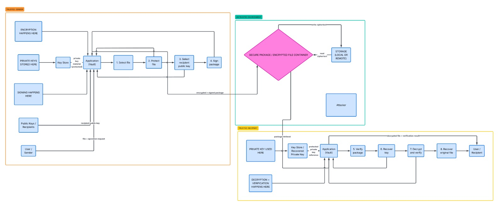

# Architecture: Secure Digital Document Vault

This document shows the system architecture and which parts are implemented at the D4 midterm checkpoint (D1 design, D2 symmetric encryption, D3 hybrid encryption).

## Architecture diagram

The design has three zones separated by trust boundaries:

- **Trusted: sender.** The file is encrypted here, and the package is built (and, in the full design, signed).
- **Untrusted environment.** Storage and network. It only ever sees the encrypted container. We assume an attacker can read, copy, modify and delete it.
- **Trusted: recipient.** The private key is used here. The recipient unwraps the file key, verifies the authentication tag and decrypts.

## Components

| Component | Role | Status |
|---|---|---|
| Vault module (`vault/symmetric.py`, `vault/hybrid/`) | Encrypts and decrypts files (D2 + D3) | Implemented |
| Keystore | Key pairs as PEM files, private key optionally password-protected | Implemented (basic) |
| Authenticated container | JSON document: metadata, recipient list, nonce, ciphertext, tag | Implemented |
| Sender signature | Proves who created the package | Planned |
| Full Key Store with password-based key derivation | Protected local storage of private keys | Planned |

## Data flow

1. **Encrypt (sender).** Generate a random 256-bit file key from the OS CSPRNG. Encrypt the file with AES-256-GCM using a random 96-bit nonce.
2. **Share (sender).** Wrap the file key separately for each recipient with RSA-OAEP (SHA-256). Each recipient entry holds an id, the SHA-256 fingerprint of the public key and the encrypted file key.
3. **Authenticate (sender).** The header and the recipient list are the associated data (AAD) of AES-GCM, so changing any of them breaks the tag.
4. **Store or send.** The container goes to any storage or network.
5. **Decrypt (recipient).** Find the own entry by id or fingerprint, unwrap the file key with the private key, verify the tag and decrypt. On any failure there is one generic error and no output file.

## Trust assumptions and limits

Assumed: secure OS randomness, authentic public keys, endpoints free of malware.
Known limits: no sender signature yet, no revocation, no forward secrecy, replay is not detected. Out of scope: denial of service on storage and protection after decryption.
