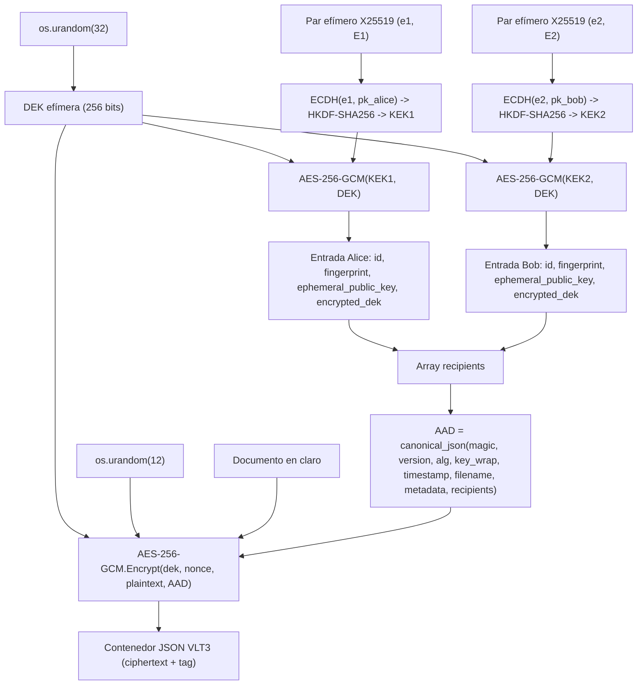

# D3 — Cifrado Híbrido Multi-Destinatario (Hybrid Encryption)

**Proyecto:** Secure Digital Document Vault  
**Módulos:** [`vault/hybrid/encryption.py`](../vault/hybrid/encryption.py) · [`vault/hybrid/keys.py`](../vault/hybrid/keys.py) · Excepciones: [`vault/exceptions.py`](../vault/exceptions.py) · Pruebas: [`tests/hybrid/test_hybrid.py`](../tests/hybrid/test_hybrid.py)  
**Entregable:** Deliverable D3 (`VLT3`, ECIES)

---

## 1. Objetivo arquitectónico y de seguridad

Permitir el **intercambio seguro de documentos entre múltiples destinatarios autorizados** mediante un esquema de **cifrado híbrido (KEM/DEM)** que combina cifrado simétrico autenticado (**AES-256-GCM**) con transporte de claves basado en **curvas elípticas (ECIES sobre X25519)**.

> **Restricción de la tarea.** El uso de RSA está prohibido en el proyecto. La versión inicial de D3 usaba RSA-OAEP y se reemplazó por una construcción ECIES. No queda ninguna operación RSA en el módulo.

> **Objetivo de seguridad.** Un documento se cifra **una única vez** mediante AEAD bajo una clave efímera de datos (DEK) de 256 bits. Cada destinatario autorizado puede descifrar de forma independiente su propia copia envuelta de la DEK utilizando su clave privada X25519. Incluso si el contenedor `VLT3` se filtra públicamente, ningún tercero no autorizado puede recuperar el texto plano ni alterar, reordenar, añadir o eliminar destinatarios sin invalidar inmediatamente el tag de autenticación AEAD.

---

## 2. Explicación del Diseño Híbrido (Hybrid Design Explanation)

### 2.1 ¿Por qué se utiliza cifrado híbrido?

1. **La criptografía asimétrica no está pensada para datos masivos.** X25519 no cifra datos: sólo permite que dos partes acuerden un secreto compartido (Diffie-Hellman sobre la curva Curve25519, RFC 7748). Para proteger un archivo hay que derivar de ese secreto una clave simétrica y cifrar el contenido con un algoritmo simétrico. Esto es exactamente un esquema híbrido: la parte asimétrica sólo protege una clave pequeña (la DEK de 32 bytes) y la parte simétrica protege el documento.
2. **Costo $O(1)$ sobre el tamaño del archivo.** Un archivo de $M$ megabytes para $R$ destinatarios se cifra **una sola vez** con AES-256-GCM (costo $O(M)$, acelerado por hardware con `AES-NI` y `PCLMULQDQ`). La parte asimétrica se ejecuta sólo $R$ veces sobre 32 bytes (costo $O(R)$ independiente de $M$), y el contenedor no se multiplica por $R$.

### 2.2 ¿Por qué sigue siendo indispensable el cifrado simétrico AEAD (AES-256-GCM)?

1. **Integridad global del documento.** AES-256-GCM es una primitiva **AEAD** (*Authenticated Encryption with Associated Data*): cifra el documento y produce un tag de 128 bits que autentica el texto cifrado **y** los datos asociados (**AAD**). Ninguna operación de curva elíptica proporciona por sí sola autenticación del contenido.
2. **Vinculación de contexto.** El encabezado del contenedor y la lista completa de destinatarios (incluidas las claves efímeras) se ligan criptográficamente al payload mediante el AAD.

### 2.3 ¿Por qué se envuelve la DEK por separado para cada destinatario?

1. **Aislamiento de credenciales privadas.** Cada destinatario $i \in \{1, \dots, R\}$ posee un par de claves independiente $(sk_i, pk_i)$ y nunca comparte $sk_i$. Si todos compartieran una misma clave, cualquiera podría suplantar a los demás y rotar o revocar la clave de un usuario obligaría a redistribuir secretos a todo el grupo.
2. **Independencia criptográfica mediante claves efímeras.** Para cada destinatario se genera un par efímero fresco $(e_i, E_i)$ y la misma DEK se envuelve de forma independiente (sección 3.2):
   $$\text{encrypted\_dek}_i = \text{AES-256-GCM}_{KEK_i}(\text{DEK}), \qquad KEK_i = \text{HKDF-SHA256}\big(\text{X25519}(e_i, pk_i)\big)$$
   Como cada $e_i$ es nuevo, cada $KEK_i$ es distinto, y ningún observador puede correlacionar dos envoltorios sin poseer la clave privada correspondiente.

---

## 3. Especificación Técnica y Formato del Contenedor (`VLT3`)

### 3.1 Parámetros criptográficos

| Componente | Especificación | Detalles de implementación |
|---|---|---|
| Biblioteca base | `cryptography >= 44.0.0` | Primitivas estándar auditadas; cero criptografía hecha a mano |
| Cifrado simétrico (DEM) | `AES-256-GCM` (`AESGCM`) | DEK de 256 bits (`32 B`), nonce de 96 bits (`12 B`), tag de 128 bits (`16 B`) |
| Envoltorio asimétrico (KEM) | **ECIES**: X25519 + HKDF-SHA256 + AES-256-GCM | Clave efímera X25519 por destinatario y por cifrado; identificador `ECIES-X25519-HKDF-SHA256-AES-256-GCM` |
| Derivación de la KEK | `HKDF-SHA256` | `salt=None`, `length=32`, `info = KEY_WRAP_INFO ‖ E ‖ pk` (etiqueta de dominio + clave efímera + clave del destinatario) |
| Envoltorio de la DEK | `AES-256-GCM` bajo la KEK | `encrypted_dek = nonce(12) ‖ DEK cifrada(32) ‖ tag(16)` = 60 bytes; AAD = `KEY_WRAP_INFO ‖ E ‖ pk` |
| Clave de destinatario | `X25519` (32 bytes) | PEM: `SubjectPublicKeyInfo` (pública) y `PKCS#8` (privada), según la decisión de formatos del equipo |
| Huella de clave pública | `SHA-256` sobre los **32 bytes crudos** de la clave pública | Cadena hexadecimal en minúsculas de 64 caracteres (`get_public_key_fingerprint`); esa forma está **reservada** y ningún `id` puede tenerla |
| Metadatos | `filename` (str o `null`) y `metadata` (objeto JSON) | Siempre presentes en el contenedor y en el AAD; en claro pero autenticados; tope de 64 KiB (`MAX_METADATA_SIZE`) |
| CSPRNG | `os.urandom()` y el generador de claves de la biblioteca | `os.urandom` para la DEK (`32 B`) y los nonces GCM (`12 B`); la clave efímera X25519 se genera con el CSPRNG de la biblioteca |

### 3.2 Construcción ECIES (envoltorio de la DEK)

Para cada destinatario con clave pública $pk$ (32 bytes):

1. Generar un par efímero X25519 $(e, E)$ con $E = e \cdot G$.
2. Calcular el secreto compartido $Z = \text{X25519}(e, pk)$. La biblioteca rechaza los puntos de orden bajo (secreto compartido nulo).
3. Derivar $KEK = \text{HKDF-SHA256}(Z,\ \text{info} = \text{KEY\_WRAP\_INFO} \Vert E \Vert pk)$, con longitud de 32 bytes.
4. Generar un nonce de 96 bits con `os.urandom(12)` y calcular $\text{wrapped} = \text{nonce} \Vert \text{AES-256-GCM}_{KEK}(\text{nonce}, \text{DEK}, \text{AAD} = \text{KEY\_WRAP\_INFO} \Vert E \Vert pk)$.
5. Guardar en la entrada del destinatario $E$ (`ephemeral_public_key`) y `wrapped` (`encrypted_dek`).

El destinatario hace el camino inverso: lee $E$, calcula $Z = \text{X25519}(sk, E)$, deriva la misma KEK y abre `wrapped`. Si cualquier byte de $E$, de `wrapped` o de la clave del destinatario es distinto, la verificación del tag falla.

**Por qué es seguro reutilizar la misma DEK entre destinatarios.** Cada envoltorio usa una KEK distinta (clave efímera nueva), de modo que nunca se repite una pareja (clave, nonce) bajo AES-GCM. El nonce de 96 bits del envoltorio es aleatorio y se usa una sola vez por KEK. Ligar $E$ y $pk$ en el `info` de HKDF y en el AAD evita que un envoltorio se reutilice con otra clave de destinatario o con otra clave efímera.

**Por qué esta construcción y no una biblioteca externa.** Se usan únicamente primitivas de `cryptography` (X25519, HKDF, AES-GCM) combinadas siguiendo el patrón de ECIES / DHIES (ECDH efímero, KDF, cifrado autenticado), sin inventar ninguna primitiva. Incluye etiqueta de dominio y vinculación de ambas claves públicas en la derivación.

### 3.3 Flujo de cifrado y descifrado híbrido



### 3.4 Estructura del contenedor `VLT3` y vinculación estricta de AAD

El contenedor se serializa en formato JSON canónico:

```json
{
  "magic": "VLT3",
  "version": 3,
  "algorithm": "AES-256-GCM",
  "key_wrap_algorithm": "ECIES-X25519-HKDF-SHA256-AES-256-GCM",
  "timestamp": 1729598400,
  "filename": "contrato.pdf",
  "metadata": {"departamento": "legal"},
  "recipients": [
    {
      "id": "alice",
      "fingerprint": "e3b0c44298fc1c149afbf4c8996fb92427ae41e4649b934ca495991b7852b855",
      "ephemeral_public_key": "<base64-32-bytes>",
      "encrypted_dek": "<base64-60-bytes: nonce || wrapped DEK || tag>"
    },
    {
      "id": "bob",
      "fingerprint": "8f434346648f6b96df89dda901c5176b10a6d83961dd3c1ac88b59b2dc327aa4",
      "ephemeral_public_key": "<base64-32-bytes>",
      "encrypted_dek": "<base64-60-bytes: nonce || wrapped DEK || tag>"
    }
  ],
  "nonce": "<base64-12-bytes>",
  "ciphertext": "<base64>",
  "tag": "<base64-16-bytes>"
}
```

**Definición exacta del AAD (Associated Authenticated Data):**

```python
AAD = canonical_json({
    "magic": "VLT3",
    "version": 3,
    "algorithm": "AES-256-GCM",
    "key_wrap_algorithm": "ECIES-X25519-HKDF-SHA256-AES-256-GCM",
    "timestamp": timestamp,
    "filename": filename,        # str o null; siempre presente
    "metadata": metadata,        # objeto; {} si no hay metadatos
    "recipients": recipients,
})
```

Donde `canonical_json` aplica `json.dumps(..., sort_keys=True, separators=(",", ":"), ensure_ascii=True, allow_nan=False).encode("utf-8")`.

`filename` y `metadata` **siempre** forman parte del contenedor y del AAD (`null` / `{}` cuando no se usan). Así, quitarlos, añadirlos o editarlos cambia el AAD y rompe el tag para *todos* los destinatarios, y un contenedor al que le falte cualquiera de los dos campos se rechaza por estructura. Se validan con las mismas reglas estrictas que el encabezado de D2: deben sobrevivir un ciclo JSON canónico sin cambios (claves `str`, números finitos, listas en vez de tuplas). `filename` es dato **no confiable**: nunca se usa para construir rutas de salida (`decrypt_file_hybrid` escribe sólo en el `output_path` indicado por quien llama).

---

## 4. Decisiones de Seguridad y Modelo de Amenazas (Security Decisions & Threat Model)

### 4.1 ¿Cómo identifican los destinatarios su clave cifrada de forma determinista y sin ambigüedad?

Cada entrada del arreglo `recipients` almacena dos selectores ligados al AAD:
1. **`id` (`recipient_id`):** identificador lógico único (por ejemplo, `"alice"` o `"alice@org.com"`).
2. **`fingerprint`:** hash **SHA-256**, en hexadecimal minúscula (64 caracteres), sobre los **32 bytes crudos** de la clave pública X25519 (el identificador de clave que decidió el equipo: SHA-256 de los bytes públicos):
   $$\text{fingerprint} = \text{Hex}\big(\text{SHA-256}(\text{raw}(pk_i))\big)$$

**Espacios de nombres disjuntos (regla anti-confusión).** La forma "64 caracteres hexadecimales en minúscula" está **reservada** a las huellas:
* Al cifrar, un `id` con esa forma se rechaza con `InvalidKeyError`.
* Al leer un contenedor, una entrada con `id` de esa forma, con `fingerprint` mal formada o con `fingerprint` repetida se rechaza como contenedor inválido.

**Búsqueda determinista, sin *fallback*.** `decrypt_*_hybrid` elige **un solo campo** según la forma del selector recibido:

| Selector (`recipient_id`) | Campo comparado |
|---|---|
| 64 hex minúsculas | `entry["fingerprint"]` |
| cualquier otra cadena no vacía | `entry["id"]` |
| `None` o `""` | huella de `private_key.public_key()` |

Como `id` y `fingerprint` son únicos y disjuntos, **como máximo una entrada coincide**: dado un identificador siempre se obtiene la misma clave o ninguna. Antes de hacer cualquier operación ECDH se comprueba que la entrada elegida lleve la huella de la clave privada usada; si no, falla con `DecryptionFailedError`. Si ninguna entrada coincide se lanza `RecipientNotFoundError` (subclase de `DecryptionFailedError`).

**Por qué esto evita la prueba y error.** Los 32 bytes crudos de la clave pública son una codificación **única y canónica** (a diferencia de PEM, que varía en saltos de línea o cabeceras). El destinatario localiza su entrada en $O(R)$ y ejecuta **una única operación de desencapsulación ECIES**, en lugar de intentar descifrar a ciegas cada `encrypted_dek`.

**Qué se corrigió respecto al diseño anterior.** Antes `id` y `fingerprint` compartían el espacio de búsqueda y el `id` tenía prioridad; un emisor podía registrar a Alice con un `id` igual a la huella de Bob y Bob, siendo destinatario legítimo, ya no podía abrir el archivo por huella. Con la regla anterior esa configuración no puede construirse ni por la API ni a mano. Cubierto por `tests/hybrid/test_key_identification.py`.

### 4.2 ¿Qué ocurre cuando un atacante intenta modificar, reordenar o truncar la lista de destinatarios?

El arreglo completo `recipients` —incluyendo el orden de sus elementos y los cuatro campos (`id`, `fingerprint`, `ephemeral_public_key`, `encrypted_dek`) de cada destinatario— forma parte integral del **AAD** inyectado en `AES-256-GCM`:

* **Eliminación de un destinatario (*Recipient Removal Attack*, p. ej., borrar a Bob):**  
  Aunque Alice conserve su entrada intacta y logre desenvolver la DEK con su clave privada X25519, al ejecutar `AESGCM(dek).decrypt(nonce, ciphertext || tag, AAD')`, el polinomio GHASH se evalúa sobre un $\text{AAD}' \ne \text{AAD}$. La verificación del tag de 128 bits falla de forma determinista (`InvalidTag` $\rightarrow$ `DecryptionFailedError`) y no se escribe ningún byte en disco.
* **Modificación de `id`, `fingerprint` o `encrypted_dek` de cualquier destinatario:**  
  Alterar un solo bit del `id`, del `fingerprint`, de la `ephemeral_public_key` o de la `encrypted_dek` de Bob invalida el tag AEAD incluso cuando quien descifra es Alice. Si se altera la `ephemeral_public_key` o la `encrypted_dek` de quien intenta descifrar, falla además el tag del propio envoltorio ECIES (la KEK derivada es distinta).
* **Adición o reordenamiento de destinatarios:**  
  Cambiar `[alice, bob]` por `[bob, alice]` o inyectar a `carol` altera los bytes del JSON canónico en `AAD`, provocando igualmente `DecryptionFailedError`.

### 4.3 ¿Qué ocurre si se suministra una clave pública inválida o suplantada (*spoofed*) durante el cifrado?

1. **Clave pública estructuralmente inválida (p. ej., de otro tipo como Ed25519 o P-256, o PEM corrupto):**  
   Las funciones [`validate_x25519_public_key`](../vault/hybrid/keys.py) y [`encrypt_file_hybrid`](../vault/hybrid/encryption.py) validan todas las claves de los destinatarios **antes** de generar el contenedor. Cualquier clave que no sea una instancia válida de `X25519PublicKey`, o que tenga un `id` o `fingerprint` duplicado, es rechazada inmediatamente con `InvalidKeyError`, sin crear archivos en disco.
2. **Clave pública criptográficamente válida pero suplantada (*Key Spoofing / MITM*, p. ej., el atacante sustituye la clave pública de Bob por la de Mallory antes de cifrar):**  
   * **Impacto criptográfico:** Si el emisor no autentica el origen de la clave pública y cifra usando la clave pública de Mallory ($pk_{\text{mallory}}$) bajo el identificador `"bob"`, el contenedor resultante incluirá el `fingerprint` de $pk_{\text{mallory}}$ y envolverá la DEK para Mallory. En consecuencia:
     1. **Bob legítimo no podrá descifrar** el contenedor: su clave privada $sk_{\text{bob}}$ fallará al desenvolver la DEK con ECIES y su huella no coincidirá con el `fingerprint` almacenado, produciendo `DecryptionFailedError`.
     2. **Mallory sí podría descifrar** el contenedor porque el emisor cifró explícitamente la DEK para $pk_{\text{mallory}}$.
   * **Mitigación y defensa en profundidad:**  
     El esquema `VLT3` expone y autentica en el AAD el campo `fingerprint` (`SHA-256` de la clave pública cruda) junto a cada `id`. El cifrado híbrido por sí solo no sustituye a una infraestructura de clave pública (**PKI / certificados X.509**) ni a la verificación fuera de banda (*Trust On First Use* / comparación de huellas SHA-256). Por ello, la aplicación o el emisor debe verificar el `fingerprint` de `get_public_key_fingerprint(pub_key)` contra un directorio de claves autenticado o certificado antes de invocar `encrypt_file_hybrid`.

### 4.4 Resumen del Modelo de Amenazas

| Amenaza / Vector de ataque | Mecanismo de defensa en D3 | Resultado |
|---|---|---|
| Destinatario no autorizado (Carol) | DEK envuelta sólo para destinatarios autorizados con ECIES (X25519 + HKDF-SHA256 + AES-256-GCM) | `RecipientNotFoundError` / `DecryptionFailedError` |
| Clave privada incorrecta para un destinatario válido | El tag del envoltorio ECIES no verifica (KEK derivada distinta) | `DecryptionFailedError` |
| Eliminación de un destinatario (*Recipient Removal*) | `recipients` completo ligado en `AAD` de AES-256-GCM | `DecryptionFailedError` (incluso para los destinatarios restantes) |
| Modificación de `id`, `fingerprint`, `ephemeral_public_key` o `encrypted_dek` | Vinculación en `AAD` + tag del envoltorio ECIES + chequeo de `fingerprint` | `DecryptionFailedError` |
| Confusión `id` / `fingerprint` (un `id` que imita la huella de otro destinatario) | Forma de huella reservada, campos únicos y búsqueda de un solo campo sin *fallback* | `InvalidKeyError` al cifrar / `DecryptionFailedError` al leer |
| Edición, inyección o eliminación de `filename` / `metadata` | Ambos campos siempre presentes y ligados al AAD | `DecryptionFailedError` para todos los destinatarios |
| Alteración de `ciphertext`, `tag`, `nonce` o `timestamp` | Autenticación AEAD (AES-256-GCM con tag de 128 bits) | `DecryptionFailedError` |
| Clave de otro tipo (no X25519) o formato PEM corrupto | Validación estricta en `vault/hybrid/keys.py` | `InvalidKeyError` antes de operar |
| Clave efímera inválida o de orden bajo, o de longitud incorrecta | Comprobación de longitud y rechazo de puntos de orden bajo en X25519 | `DecryptionFailedError` |
| Intercambio o reutilización de claves efímeras entre destinatarios | `E` y `pk` ligadas en el `info` de HKDF, en el AAD del envoltorio y en el AAD del contenedor | `DecryptionFailedError` |
| Contenedor del formato anterior (`VLT2`, con RSA) | `magic` y `version` verificados estrictamente | `DecryptionFailedError` |
| Fuga de datos parciales en disco tras error | Verificación íntegra en memoria antes de abrir `output_path` + limpieza en `OSError` | Cero archivos parciales o temporales |

### 4.5 Limitaciones conocidas (fuera del alcance de D3)

* **Sin autenticación del remitente.** El AAD detecta que un tercero ajeno altere el contenedor, pero **cualquier destinatario** conoce la DEK y las claves públicas, así que podría fabricar un contenedor nuevo y válido (otra lista, otro contenido) que parezca legítimo. Probar *quién* cifró requiere una **firma digital** del contenedor (p. ej. Ed25519), que no forma parte de este entregable.
* **Quitar a alguien no revoca el acceso previo.** Quien ya descifró conserva el contenido y la DEK; compartir con otra lista exige volver a cifrar con una DEK nueva.
* **La lista de destinatarios y los metadatos no son secretos.** `id`, `fingerprint`, `filename` y `metadata` viajan en claro (autenticados, no cifrados). Usar `include_filename=False` o evitar datos sensibles en ellos.
* **Sin *forward secrecy*.** Si la clave privada X25519 de un destinatario se compromete en el futuro, todos los contenedores pasados dirigidos a ella quedan expuestos (la clave efímera del emisor se descarta, pero la del destinatario es de larga duración).
* **Autenticidad de las claves públicas.** El esquema no verifica a quién pertenece una clave pública; hay que compararla fuera de banda (ver 4.3).

---

## 5. Trazabilidad de Pruebas (`tests/hybrid/test_hybrid.py`)

| Caso de prueba obligatorio | Clase / Prueba en `tests/hybrid/test_hybrid.py` |
|---|---|
| 1. Descifrado multi-destinatario (Alice y Bob byte a byte) | `TestMultiRecipientDecryption::test_alice_and_bob_decrypt_exact_original_file`, `test_multi_recipient_various_payload_sizes`, `test_recipient_identification_by_fingerprint` |
| 2. Rechazo de destinatario no autorizado (Carol) | `TestUnauthorizedRecipientRejection::test_unlisted_recipient_carol_is_rejected`, `test_unlisted_recipient_by_fingerprint_is_rejected` |
| 3. Clave privada incorrecta | `TestWrongPrivateKey::test_decrypt_alice_entry_with_carol_private_key_fails`, `test_decrypt_alice_entry_with_bob_private_key_fails` |
| 4. Lista de destinatarios manipulada (`id`, `fingerprint`, `encrypted_dek`, orden) | `TestTamperedRecipientList::test_tampered_recipient_id_breaks_aead_tag`, `test_tampered_recipient_fingerprint_breaks_aead_tag`, `test_tampered_encrypted_dek_single_byte_fails`, `test_reordered_or_injected_recipient_list_breaks_aead_tag` |
| 5. Ataque de eliminación de destinatario (quitar a Bob rompe a Alice) | `TestRecipientRemovalAttack::test_stripping_bob_causes_alice_decryption_to_fail` |
| 6. Ciphertext o tag corrupto (1 bit alterado) | `TestCorruptedCiphertextAndTag::test_single_bit_flip_in_ciphertext_fails`, `test_single_bit_flip_in_tag_fails`, `test_single_bit_flip_in_nonce_or_timestamp_fails` |
| 7. Gestión de claves X25519, PEM, fingerprints y CSPRNG | `TestKeysAndSecurityHygiene`, `tests/hybrid/test_keys.py` |
| 10. Construcción ECIES: claves efímeras únicas, equivalencia con una implementación independiente, manipulación y rechazo de claves efímeras | `tests/hybrid/test_ecies.py` (`TestEphemeralKeys`, `TestConstructionMatchesDocumentation`, `TestEphemeralKeyTampering`, `TestKeyWrapBinding`) |
| 8. Identificación determinista y sin confusión (`id` vs. `fingerprint`) | `tests/hybrid/test_key_identification.py` (`TestEncryptRejectsConfusableIds`, `TestDeterministicLookup`, `TestContainerNamespaceIsEnforcedOnRead`) |
| 9. `filename` / `metadata` autenticados y siempre presentes | `tests/hybrid/test_metadata.py` (`TestAadBinding`, `TestTamperingBreaksEveryRecipient`, `TestInvalidMetadataRejectedOnEncrypt`, `TestFileApi`) |

Ejecución de la suite completa:

```bash
.venv/bin/python -m pytest -v
```
