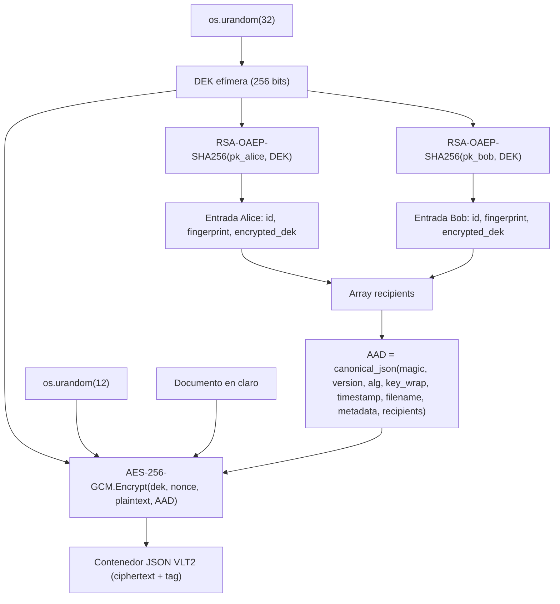

# D3 — Cifrado Híbrido Multi-Destinatario (Hybrid Encryption)

**Proyecto:** Secure Digital Document Vault  
**Módulos:** [`vault/hybrid/encryption.py`](../vault/hybrid/encryption.py) · [`vault/hybrid/keys.py`](../vault/hybrid/keys.py) · Excepciones: [`vault/exceptions.py`](../vault/exceptions.py) · Pruebas: [`tests/hybrid/test_hybrid.py`](../tests/hybrid/test_hybrid.py)  
**Entregable:** Deliverable D3 (`VLT2`)

---

## 1. Objetivo arquitectónico y de seguridad

Permitir el **intercambio seguro de documentos entre múltiples destinatarios autorizados** mediante un esquema de **cifrado híbrido (KEM/DEM)** que combina cifrado simétrico autenticado (**AES-256-GCM**) con transporte asimétrico de claves (**RSA-OAEP-SHA256**).

> **Objetivo de seguridad.** Un documento se cifra **una única vez** mediante AEAD bajo una clave efímera de datos (DEK) de 256 bits. Cada destinatario autorizado puede descifrar de forma independiente su propia copia envuelta de la DEK utilizando su clave privada RSA. Incluso si el contenedor `VLT2` se filtra públicamente, ningún tercero no autorizado puede recuperar el texto plano ni alterar, reordenar, añadir o eliminar destinatarios sin invalidar inmediatamente el tag de autenticación AEAD.

---

## 2. Explicación del Diseño Híbrido (Hybrid Design Explanation)

### 2.1 ¿Por qué se utiliza cifrado híbrido? (Rendimiento y límites de tamaño asimétricos)

1. **Límite matemático estricto de tamaño en RSA-OAEP:**  
   Una operación de cifrado RSA opera sobre el anillo $\mathbb{Z}_n$ donde $n$ es el módulo de $k$ bytes ($k = 256\text{ B}$ para RSA-2048). El esquema de relleno probabilístico **RSA-OAEP** (RFC 8017, §7.1.1) reserva $2 \cdot hLen + 2$ bytes para el hash y delimitadores. Con **SHA-256** ($hLen = 32\text{ B}$), la carga útil máxima que puede cifrar directamente una clave RSA-2048 es:
   $$\text{Máximo plaintext RSA-OAEP} = 256 - 2(32) - 2 = 190\text{ bytes}$$
   Un documento real (PDF, imagen, base de datos) supera por órdenes de magnitud esos 190 bytes; en cambio, una clave simétrica **DEK de 32 bytes (256 bits)** cabe holgadamente dentro de una única operación RSA-OAEP.
2. **Rendimiento computacional y escalabilidad $O(1)$ sobre el tamaño del archivo:**  
   La exponenciación modular RSA ($c = m^e \bmod n$ y $m = c^d \bmod n$) requiere aritmética de multiprecisión sobre enteros de 2048 a 4096 bits, siendo miles de veces más costosa por byte que **AES-256-GCM** acelerado por instrucciones de hardware (`AES-NI` y `PCLMULQDQ`). Con cifrado híbrido, un archivo de $M$ megabytes para $R$ destinatarios se cifra **una sola vez** con AES-256-GCM (costo $O(M)$) y RSA-OAEP sólo se ejecuta $R$ veces sobre 32 bytes (costo $O(R)$ independiente de $M$), evitando además multiplicar por $R$ el tamaño del contenedor en disco.

### 2.2 ¿Por qué sigue siendo indispensable el cifrado simétrico AEAD (AES-256-GCM)?

Cifrar datos masivos directamente con RSA (por ejemplo, dividiendo el archivo en bloques de 190 bytes) es **inseguro e computacionalmente inviable**:

1. **Ausencia de integridad global y vulnerabilidad a ataques de reordenamiento/truncamiento:**  
   Aunque RSA-OAEP es seguro frente a ataques de texto cifrado elegido (**IND-CCA2**) para un mensaje individual (como una DEK de 32 bytes), cifrar un archivo troceado en múltiples bloques RSA independientes no autentica la secuencia completa: un atacante podría **eliminar bloques finales, duplicar bloques o intercambiar el orden de dos bloques RSA** sin que la verificación individual de OAEP lo detecte.
2. **Necesidad de autenticación criptográfica (INT-CTXT) y vinculación de contexto (AAD):**  
   **AES-256-GCM** es una primitiva **AEAD** (*Authenticated Encryption with Associated Data*) que cifra el documento de longitud arbitraria y produce un tag de autenticación de 128 bits sobre el texto cifrado **y** sobre los metadatos asociados (**AAD**). Esto permite vincular criptográficamente el encabezado del contenedor y la lista completa de destinatarios al payload cifrado, algo que RSA por sí solo no proporciona.

### 2.3 ¿Por qué se requiere cifrar la DEK por separado para cada destinatario?

1. **Aislamiento de credenciales privadas:**  
   Cada destinatario $i \in \{1, \dots, R\}$ posee un par de claves asimétricas independiente $(sk_i, pk_i)$ y jamás comparte su clave privada $sk_i$. Si todos compartieran una misma clave de desencapsulación, cualquier destinatario podría suplantar a los demás y revocar o rotar la clave de un usuario obligaría a redistribuir secretos a todo el grupo.
2. **Independencia criptográfica mediante aleatoriedad OAEP:**  
   Para cada destinatario $i$, la misma $\text{DEK} \in \{0,1\}^{256}$ se envuelve de forma independiente:
   $$\text{encrypted\_dek}_i = \text{RSA-OAEP-SHA256.Encrypt}(pk_i, \text{DEK})$$
   Dado que OAEP inyecta una semilla aleatoria fresca de 256 bits en cada invocación antes de aplicar `MGF1-SHA256`, cada $\text{encrypted\_dek}_i$ es probabilísticamente independiente. Ningún observador puede correlacionar dos envoltorios sin poseer las claves privadas correspondientes, y cada destinatario autorizado puede recuperar la DEK usando exclusivamente su propia $sk_i$.

---

## 3. Especificación Técnica y Formato del Contenedor (`VLT2`)

### 3.1 Parámetros criptográficos

| Componente | Especificación | Detalles de implementación |
|---|---|---|
| Biblioteca base | `cryptography >= 44.0.0` | Primitivas estándar auditadas; cero criptografía hecha a mano |
| Cifrado simétrico (DEM) | `AES-256-GCM` (`AESGCM`) | DEK de 256 bits (`32 B`), nonce de 96 bits (`12 B`), tag de 128 bits (`16 B`) |
| Envoltorio asimétrico (KEM) | `RSA-OAEP-SHA256` | `padding.OAEP(mgf=padding.MGF1(hashes.SHA256()), algorithm=hashes.SHA256(), label=None)` |
| Tamaño de clave RSA | $\ge 2048$ bits (recomendado $3072$/$4096$) | Exponente público $e = 65537$; se rechazan claves $< 2048$ bits con `InvalidKeyError` |
| Huella de clave pública | `SHA-256` sobre DER `SubjectPublicKeyInfo` | Cadena hexadecimal en minúsculas de 64 caracteres (`get_public_key_fingerprint`); esa forma está **reservada** y ningún `id` puede tenerla |
| Metadatos | `filename` (str o `null`) y `metadata` (objeto JSON) | Siempre presentes en el contenedor y en el AAD; en claro pero autenticados; tope de 64 KiB (`MAX_METADATA_SIZE`) |
| CSPRNG | `os.urandom()` | Fuente única para la DEK (`32 B`) y el nonce GCM (`12 B`) |

### 3.2 Flujo de cifrado y descifrado híbrido



### 3.3 Estructura del contenedor `VLT2` y vinculación estricta de AAD

El contenedor se serializa en formato JSON canónico:

```json
{
  "magic": "VLT2",
  "version": 2,
  "algorithm": "AES-256-GCM",
  "key_wrap_algorithm": "RSA-OAEP-SHA256",
  "timestamp": 1729598400,
  "filename": "contrato.pdf",
  "metadata": {"departamento": "legal"},
  "recipients": [
    {
      "id": "alice",
      "fingerprint": "e3b0c44298fc1c149afbf4c8996fb92427ae41e4649b934ca495991b7852b855",
      "encrypted_dek": "<base64-rsa-oaep-wrapped-dek>"
    },
    {
      "id": "bob",
      "fingerprint": "8f434346648f6b96df89dda901c5176b10a6d83961dd3c1ac88b59b2dc327aa4",
      "encrypted_dek": "<base64-rsa-oaep-wrapped-dek>"
    }
  ],
  "nonce": "<base64-12-bytes>",
  "ciphertext": "<base64>",
  "tag": "<base64-16-bytes>"
}
```

**Definición exacta del AAD (Associated Authenticated Data):**

```python
AAD = canonical_json({
    "magic": "VLT2",
    "version": 2,
    "algorithm": "AES-256-GCM",
    "key_wrap_algorithm": "RSA-OAEP-SHA256",
    "timestamp": timestamp,
    "filename": filename,        # str o null; siempre presente
    "metadata": metadata,        # objeto; {} si no hay metadatos
    "recipients": recipients,
})
```

Donde `canonical_json` aplica `json.dumps(..., sort_keys=True, separators=(",", ":"), ensure_ascii=True, allow_nan=False).encode("utf-8")`.

`filename` y `metadata` **siempre** forman parte del contenedor y del AAD (`null` / `{}` cuando no se usan). Así, quitarlos, añadirlos o editarlos cambia el AAD y rompe el tag para *todos* los destinatarios, y un contenedor al que le falte cualquiera de los dos campos se rechaza por estructura. Se validan con las mismas reglas estrictas que el encabezado de D2: deben sobrevivir un ciclo JSON canónico sin cambios (claves `str`, números finitos, listas en vez de tuplas). `filename` es dato **no confiable**: nunca se usa para construir rutas de salida (`decrypt_file_hybrid` escribe sólo en el `output_path` indicado por quien llama).

---

## 4. Decisiones de Seguridad y Modelo de Amenazas (Security Decisions & Threat Model)

### 4.1 ¿Cómo identifican los destinatarios su clave cifrada de forma determinista y sin ambigüedad?

Cada entrada del arreglo `recipients` almacena dos selectores ligados al AAD:
1. **`id` (`recipient_id`):** identificador lógico único (por ejemplo, `"alice"` o `"alice@org.com"`).
2. **`fingerprint`:** hash **SHA-256**, en hexadecimal minúscula (64 caracteres), sobre la codificación canónica **ASN.1 DER (`SubjectPublicKeyInfo`)** de la clave pública RSA:
   $$\text{fingerprint} = \text{Hex}\big(\text{SHA-256}(\text{DER}_{\text{SPKI}}(pk_i))\big)$$

**Espacios de nombres disjuntos (regla anti-confusión).** La forma "64 caracteres hexadecimales en minúscula" está **reservada** a las huellas:
* Al cifrar, un `id` con esa forma se rechaza con `InvalidKeyError`.
* Al leer un contenedor, una entrada con `id` de esa forma, con `fingerprint` mal formada o con `fingerprint` repetida se rechaza como contenedor inválido.

**Búsqueda determinista, sin *fallback*.** `decrypt_*_hybrid` elige **un solo campo** según la forma del selector recibido:

| Selector (`recipient_id`) | Campo comparado |
|---|---|
| 64 hex minúsculas | `entry["fingerprint"]` |
| cualquier otra cadena no vacía | `entry["id"]` |
| `None` o `""` | huella de `private_key.public_key()` |

Como `id` y `fingerprint` son únicos y disjuntos, **como máximo una entrada coincide**: dado un identificador siempre se obtiene la misma clave o ninguna. Antes de operar con RSA se comprueba que la entrada elegida lleve la huella de la clave privada usada; si no, falla con `DecryptionFailedError`. Si ninguna entrada coincide se lanza `RecipientNotFoundError` (subclase de `DecryptionFailedError`).

**Por qué esto evita la prueba y error.** La codificación DER de `SubjectPublicKeyInfo` es **única y canónica** (a diferencia de PEM, que varía en saltos de línea o cabeceras). El destinatario localiza su entrada en $O(R)$ y ejecuta **una única operación de desencapsulación RSA-OAEP**, en lugar de intentar descifrar a ciegas cada `encrypted_dek`.

**Qué se corrigió respecto al diseño anterior.** Antes `id` y `fingerprint` compartían el espacio de búsqueda y el `id` tenía prioridad; un emisor podía registrar a Alice con un `id` igual a la huella de Bob y Bob, siendo destinatario legítimo, ya no podía abrir el archivo por huella. Con la regla anterior esa configuración no puede construirse ni por la API ni a mano. Cubierto por `tests/hybrid/test_key_identification.py`.

### 4.2 ¿Qué ocurre cuando un atacante intenta modificar, reordenar o truncar la lista de destinatarios?

El arreglo completo `recipients` —incluyendo el orden de sus elementos y los tres campos (`id`, `fingerprint`, `encrypted_dek`) de cada destinatario— forma parte integral del **AAD** inyectado en `AES-256-GCM`:

* **Eliminación de un destinatario (*Recipient Removal Attack*, p. ej., borrar a Bob):**  
  Aunque Alice conserve su entrada intacta y logre desenvolver la DEK con su clave privada RSA, al ejecutar `AESGCM(dek).decrypt(nonce, ciphertext || tag, AAD')`, el polinomio GHASH se evalúa sobre un $\text{AAD}' \ne \text{AAD}$. La verificación del tag de 128 bits falla de forma determinista (`InvalidTag` $\rightarrow$ `DecryptionFailedError`) y no se escribe ningún byte en disco.
* **Modificación de `id`, `fingerprint` o `encrypted_dek` de cualquier destinatario:**  
  Alterar un solo bit del `id`, del `fingerprint` o de la `encrypted_dek` de Bob invalida el tag AEAD incluso cuando quien descifra es Alice. Si se altera la `encrypted_dek` de quien intenta descifrar, fallan tanto el relleno RSA-OAEP como el tag AEAD.
* **Adición o reordenamiento de destinatarios:**  
  Cambiar `[alice, bob]` por `[bob, alice]` o inyectar a `carol` altera los bytes del JSON canónico en `AAD`, provocando igualmente `DecryptionFailedError`.

### 4.3 ¿Qué ocurre si se suministra una clave pública inválida o suplantada (*spoofed*) durante el cifrado?

1. **Clave pública estructuralmente inválida o débil (p. ej., no RSA, corrupta o $< 2048$ bits):**  
   Las funciones [`validate_rsa_public_key`](../vault/hybrid/keys.py) y [`encrypt_file_hybrid`](../vault/hybrid/encryption.py) validan todas las claves de los destinatarios **antes** de generar el contenedor. Cualquier clave que no sea una instancia válida de `RSAPublicKey`, tenga menos de 2048 bits, o tenga un `id` o `fingerprint` duplicado es rechazada inmediatamente con `InvalidKeyError`, sin crear archivos en disco.
2. **Clave pública criptográficamente válida pero suplantada (*Key Spoofing / MITM*, p. ej., el atacante sustituye la clave pública de Bob por la de Mallory antes de cifrar):**  
   * **Impacto criptográfico:** Si el emisor no autentica el origen de la clave pública y cifra usando la clave pública de Mallory ($pk_{\text{mallory}}$) bajo el identificador `"bob"`, el contenedor resultante incluirá el `fingerprint` de $pk_{\text{mallory}}$ y envolverá la DEK para Mallory. En consecuencia:
     1. **Bob legítimo no podrá descifrar** el contenedor: su clave privada $sk_{\text{bob}}$ fallará al desenvolver la DEK con RSA-OAEP y su huella no coincidirá con el `fingerprint` almacenado, produciendo `DecryptionFailedError`.
     2. **Mallory sí podría descifrar** el contenedor porque el emisor cifró explícitamente la DEK para $pk_{\text{mallory}}$.
   * **Mitigación y defensa en profundidad:**  
     El esquema `VLT2` expone y autentica en el AAD el campo `fingerprint` (`SHA-256` del `SubjectPublicKeyInfo` DER) junto a cada `id`. El cifrado híbrido por sí solo no sustituye a una infraestructura de clave pública (**PKI / certificados X.509**) ni a la verificación fuera de banda (*Trust On First Use* / comparación de huellas SHA-256). Por ello, la aplicación o el emisor debe verificar el `fingerprint` de `get_public_key_fingerprint(pub_key)` contra un directorio de claves autenticado o certificado antes de invocar `encrypt_file_hybrid`.

### 4.4 Resumen del Modelo de Amenazas

| Amenaza / Vector de ataque | Mecanismo de defensa en D3 | Resultado |
|---|---|---|
| Destinatario no autorizado (Carol) | DEK envuelta sólo para destinatarios autorizados con RSA-OAEP-SHA256 | `RecipientNotFoundError` / `DecryptionFailedError` |
| Clave privada incorrecta para un destinatario válido | Verificación estructural de RSA-OAEP (SHA-256 + MGF1) | `DecryptionFailedError` |
| Eliminación de un destinatario (*Recipient Removal*) | `recipients` completo ligado en `AAD` de AES-256-GCM | `DecryptionFailedError` (incluso para los destinatarios restantes) |
| Modificación de `id`, `fingerprint` o `encrypted_dek` | Vinculación en `AAD` + validación RSA-OAEP + chequeo de `fingerprint` | `DecryptionFailedError` |
| Confusión `id` / `fingerprint` (un `id` que imita la huella de otro destinatario) | Forma de huella reservada, campos únicos y búsqueda de un solo campo sin *fallback* | `InvalidKeyError` al cifrar / `DecryptionFailedError` al leer |
| Edición, inyección o eliminación de `filename` / `metadata` | Ambos campos siempre presentes y ligados al AAD | `DecryptionFailedError` para todos los destinatarios |
| Alteración de `ciphertext`, `tag`, `nonce` o `timestamp` | Autenticación AEAD (AES-256-GCM con tag de 128 bits) | `DecryptionFailedError` |
| Clave RSA débil ($< 2048$ bits) o formato PEM corrupto | Validación estricta en `vault/hybrid/keys.py` | `InvalidKeyError` antes de operar |
| Fuga de datos parciales en disco tras error | Verificación íntegra en memoria antes de abrir `output_path` + limpieza en `OSError` | Cero archivos parciales o temporales |

### 4.5 Limitaciones conocidas (fuera del alcance de D3)

* **Sin autenticación del remitente.** El AAD detecta que un tercero ajeno altere el contenedor, pero **cualquier destinatario** conoce la DEK y las claves públicas, así que podría fabricar un contenedor nuevo y válido (otra lista, otro contenido) que parezca legítimo. Probar *quién* cifró requiere una **firma digital** del contenedor (p. ej. RSA-PSS o Ed25519), que no forma parte de este entregable.
* **Quitar a alguien no revoca el acceso previo.** Quien ya descifró conserva el contenido y la DEK; compartir con otra lista exige volver a cifrar con una DEK nueva.
* **La lista de destinatarios y los metadatos no son secretos.** `id`, `fingerprint`, `filename` y `metadata` viajan en claro (autenticados, no cifrados). Usar `include_filename=False` o evitar datos sensibles en ellos.
* **Sin *forward secrecy*.** Si una clave privada RSA se compromete en el futuro, todos los contenedores pasados dirigidos a ella quedan expuestos.
* **Autenticidad de las claves públicas.** El esquema no verifica a quién pertenece una clave pública; hay que compararla fuera de banda (ver 4.3).

---

## 5. Trazabilidad de Pruebas (`tests/hybrid/test_hybrid.py`)

| Caso de prueba obligatorio | Clase / Prueba en `tests/hybrid/test_hybrid.py` |
|---|---|
| 1. Descifrado multi-destinatario (Alice y Bob byte a byte) | `TestMultiRecipientDecryption::test_alice_and_bob_decrypt_exact_original_file`, `test_multi_recipient_various_payload_sizes`, `test_recipient_identification_by_fingerprint` |
| 2. Rechazo de destinatario no autorizado (Carol) | `TestUnauthorizedRecipientRejection::test_unlisted_recipient_carol_is_rejected`, `test_unlisted_recipient_by_fingerprint_is_rejected` |
| 3. Clave privada incorrecta | `TestWrongPrivateKey::test_decrypt_alice_entry_with_carol_private_key_fails`, `test_decrypt_alice_entry_with_bob_private_key_fails` |
| 4. Lista de destinatarios manipulada (`id`, `fingerprint`, `encrypted_dek`, orden) | `TestTamperedRecipientList::test_tampered_recipient_id_breaks_aead_tag`, `test_tampered_recipient_fingerprint_breaks_aead_tag`, `test_tampered_encrypted_dek_single_byte_fails`, `test_reordered_or_injected_recipient_list_breaks_aead_tag` |
| 5. Ataque de eliminación de destinatario (quitar a Bob rompe a Alice) | `TestRecipientRemovalAttack::test_stripping_bob_causes_alice_decryption_to_fail` |
| 6. Ciphertext o tag corrupto (1 bit alterado) | `TestCorruptedCiphertextAndTag::test_single_bit_flip_in_ciphertext_fails`, `test_single_bit_flip_in_tag_fails`, `test_single_bit_flip_in_nonce_or_timestamp_fails` |
| 7. Gestión de claves RSA, PEM, fingerprints y CSPRNG | `TestKeysAndSecurityHygiene` |
| 8. Identificación determinista y sin confusión (`id` vs. `fingerprint`) | `tests/hybrid/test_key_identification.py` (`TestEncryptRejectsConfusableIds`, `TestDeterministicLookup`, `TestContainerNamespaceIsEnforcedOnRead`) |
| 9. `filename` / `metadata` autenticados y siempre presentes | `tests/hybrid/test_metadata.py` (`TestAadBinding`, `TestTamperingBreaksEveryRecipient`, `TestInvalidMetadataRejectedOnEncrypt`, `TestFileApi`) |

Ejecución de la suite completa:

```bash
.venv/bin/python -m pytest -v
```
