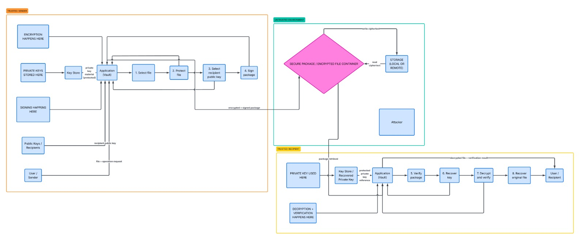

# Architecture: Secure Digital Document Vault

This document shows the system architecture across Deliverables D1 through D5 (D1 design, D2 symmetric encryption, D3 multi-recipient hybrid encryption, D4 architecture review, and D5 digital signatures & origin authentication).

## Architecture diagram

The design has three zones separated by trust boundaries:

- **Trusted: sender.** The file is encrypted here, metadata and recipients are bound into the container, and the canonical container payload is hashed (SHA-256) and signed with the sender's Ed25519 private key.
- **Untrusted environment.** Storage and network. It only ever sees the signed and encrypted container (`VLT3`). We assume an attacker can read, copy, modify and delete it.
- **Trusted: recipient.** The sender's Ed25519 signature is verified here **first** before any decryption is attempted. Only if the signature is valid does the recipient unwrap the file key with their RSA private key, verify the AES-256-GCM authentication tag, and decrypt.

## Components

| Component | Role | Status |
|---|---|---|
| Vault symmetric & hybrid modules (`vault/symmetric.py`, `vault/hybrid/`) | Encrypts and decrypts files (D2 + D3) | Implemented |
| Digital signature module (`vault/signatures/`) | Ed25519 + SHA-256 Encrypt-then-Sign & Verify-then-Decrypt (`VLT3`, D5) | Implemented |
| Keystore | RSA & Ed25519 key pairs as PEM files, private keys optionally password-protected (`0600`) | Implemented |
| Authenticated & signed container (`VLT3`) | Canonical JSON document: metadata, signer ID/fingerprint, recipient list, nonce, ciphertext, tag, and 64-byte Ed25519 signature | Implemented |
| Full Key Store with password-based key derivation | Protected local storage of private keys | Planned |

## Data flow

1. **Encrypt (sender).** Generate a random 256-bit file key (DEK) from the OS CSPRNG. Encrypt the file with AES-256-GCM using a random 96-bit nonce.
2. **Share (sender).** Wrap the file key separately for each recipient with RSA-OAEP (SHA-256). Each recipient entry holds an `id`, the SHA-256 fingerprint of the RSA public key, and the encrypted file key.
3. **Bind AAD (sender).** The header (including `signer_id`, `signer_fingerprint`, and `signature_algorithm`) and the recipient list are bound as the associated data (AAD) of AES-GCM.
4. **Sign (sender).** Serialize the canonical unsigned container (metadata + recipients + nonce + ciphertext + tag), compute its domain-separated SHA-256 digest, and sign with the sender's Ed25519 private key (`VLT3`).
5. **Store or send.** The signed container goes to any storage or network.
6. **Verify then decrypt (recipient).** Verify the sender's Ed25519 signature over the canonical container **before** touching the RSA private key. Only if valid, find the recipient's own entry by `id` or `fingerprint`, unwrap the file key with RSA-OAEP-SHA256, verify the GCM tag, and decrypt. On any failure, abort immediately without writing any output file.
