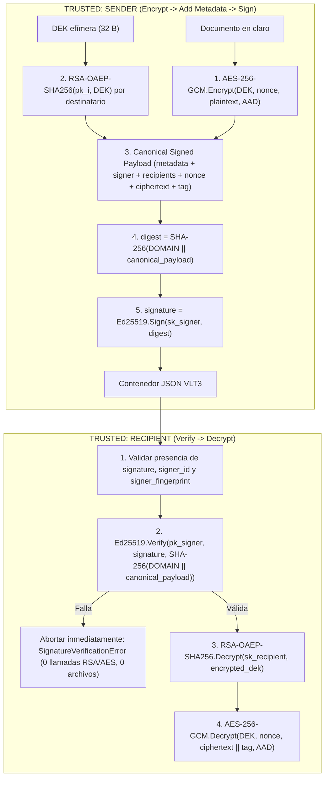

# D5 — Firmas Digitales y Autenticación de Origen (Digital Signatures & Origin Authentication)

**Proyecto:** Secure Digital Document Vault  
**Módulos:** [`vault/signatures/signing.py`](../vault/signatures/signing.py) · [`vault/signatures/keys.py`](../vault/signatures/keys.py) · [`vault/hybrid/encryption.py`](../vault/hybrid/encryption.py) · Excepciones: [`vault/exceptions.py`](../vault/exceptions.py) · Pruebas: [`tests/signatures/test_signatures.py`](../tests/signatures/test_signatures.py)  
**Entregable:** Deliverable D5 (`VLT3`)

---

## 1. Objetivo arquitectónico y de seguridad

Completar la arquitectura criptográfica del **Secure Digital Document Vault** integrando **firmas digitales y autenticación de origen** bajo el paradigma **Encrypt-then-Sign** (`Encrypt -> Add Metadata -> Sign -> Store`) y el flujo estricto de verificación previa al descifrado **Verify-then-Decrypt** (`Verify Signature -> Unwrap DEK -> Decrypt Payload`).

> **Objetivo de seguridad.** En el Entregable D3 (`VLT2`), el tag AEAD (`AES-256-GCM`) garantizaba que ningún tercero externo pudiera alterar el contenedor, pero **cualquier destinatario autorizado** conocía la DEK y las claves públicas, por lo que podía fabricar un contenedor válido haciéndose pasar por el remitente. En **D5 (`VLT3`)**, el emisor firma criptográficamente la representación canónica completa del contenedor (metadatos, identidad y huella del firmante, lista de destinatarios, `nonce`, `ciphertext` y `tag`) utilizando su clave privada **Ed25519** tras un pre-hash **SHA-256** con separación de dominio. Ningún destinatario ni atacante puede falsificar el origen del paquete, y cualquier modificación de un solo bit es rechazada en la etapa de verificación de firma **antes** de tocar la clave privada RSA del destinatario o el motor de descifrado AES-GCM.

---

## 2. Diseño de la Firma Digital (Signature Design)

### 2.1 Algoritmo elegido (`Ed25519` + pre-hash `SHA-256`) y justificación técnica

El sistema emplea **Ed25519** (EdDSA sobre la curva de Edwards torcida **Curve25519**, estandarizado en RFC 8032 y FIPS 186-5) mediante `cryptography.hazmat.primitives.asymmetric.ed25519`, precedido por un resumen criptográfico explícito **SHA-256**:

1. **Firmas completamente deterministas (inmunidad ante fallos de CSPRNG al firmar):**  
   A diferencia de ECDSA o DSA tradicionales —donde un fallo o colisión en el generador aleatorio del nonce efímero $k$ revela algebraicamente la clave privada del firmante en una sola resta modular—, **Ed25519** deriva el escalar efímero $r$ de forma determinista mediante el hash del secreto privado y del mensaje. Firmar dos veces el mismo payload canónico produce exactamente los mismos 64 bytes de firma sin depender de entropía en tiempo de firma.
2. **Ejecución en tiempo constante (*Constant-Time*) y resistencia a canales laterales:**  
   La ley de grupo completa sobre la curva de Edwards torcida permite implementar la multiplicación escalar sin ramificaciones dependientes de secretos ni accesos de memoria indexados por bits privados, mitigando ataques de temporización (*timing attacks*) y de caché, además de evitar la complejidad del relleno probabilístico de `RSA-PSS`.
3. **Compacidad y alto rendimiento (~128 bits de seguridad):**  
   Una clave pública `Ed25519` ocupa **32 bytes** (frente a 256–512 bytes en RSA-2048/4096) y una firma ocupa **64 bytes** fijos, manteniendo verificación ultrarrápida antes del descifrado.

| Componente | Especificación en D5 (`VLT3`) | Detalles de implementación |
|---|---|---|
| Cifrado simétrico (DEM) | `AES-256-GCM` (`AESGCM`) | DEK de 256 bits (`32 B`), nonce de 96 bits (`12 B`), tag de 128 bits (`16 B`) |
| Envoltorio de clave (KEM) | `RSA-OAEP-SHA256` | Claves RSA $\ge 2048$ bits; DEK envuelta por destinatario |
| Pre-hash del contenedor | `SHA-256` con separación de dominio | `SHA-256(b"VLT3-ED25519-SHA256-v1:" \|\| canonical_payload)` (`32 B`) |
| Algoritmo de firma | `Ed25519` (RFC 8032) | Clave pública de `32 B`, firma determinista de `64 B` en Base64 |
| Huella del firmante (`signer_fingerprint`) | `SHA-256` sobre DER `SubjectPublicKeyInfo` | 64 caracteres hexadecimales en minúscula (`get_signer_public_key_fingerprint`) |

### 2.2 Especificación exacta de los datos firmados (`Canonical Signed Payload`)

La firma digital cubre **absolutamente todos los campos del contenedor `VLT3` excepto el propio campo `"signature"`**. La función [`build_canonical_signed_payload`](../vault/signatures/signing.py) construye la secuencia exacta de bytes UTF-8 mediante JSON canónico (`sort_keys=True, separators=(",", ":"), ensure_ascii=True, allow_nan=False`):

```python
canonical_payload = canonical_json({
    "magic": "VLT3",
    "version": 3,
    "algorithm": "AES-256-GCM",
    "key_wrap_algorithm": "RSA-OAEP-SHA256",
    "signature_algorithm": "Ed25519",
    "timestamp": timestamp,                    # int UTC epoch
    "signer_id": signer_id,                    # str lógico (espacio disjunto de fingerprint)
    "signer_fingerprint": signer_fingerprint,  # 64 hex SHA-256(DER SPKI de Ed25519PublicKey)
    "filename": filename,                      # str o null (siempre presente)
    "metadata": metadata,                      # dict JSON canónico ({} si vacío)
    "recipients": [                            # lista ordenada completa de destinatarios
        {
            "id": recipient_id,
            "fingerprint": recipient_rsa_spki_sha256,
            "encrypted_dek": base64_rsa_oaep_dek,
        },
        # ...
    ],
    "nonce": base64_12_byte_gcm_nonce,
    "ciphertext": base64_encrypted_payload,
    "tag": base64_16_byte_gcm_tag,
})
```

A continuación, el pipeline **Hash -> Sign -> Verify** opera sobre `canonical_payload`:

$$\text{digest} = \text{SHA-256}\big(\texttt{"VLT3-ED25519-SHA256-v1:"} \;\|\; \text{canonical\_payload}\big) \in \{0,1\}^{256}$$

$$\text{signature} = \text{Ed25519.Sign}(sk_{\text{signer}}, \text{digest}) \in \{0,1\}^{512} \quad (64\text{ bytes})$$

### 2.3 ¿Por qué es necesario aplicar hash (`SHA-256`) antes de firmar?

1. **Compresión de longitud arbitraria a un resumen de tamaño fijo resistente a colisiones:**  
   Un contenedor `VLT3` puede almacenar desde unos pocos bytes hasta cientos de megabytes de `ciphertext`. La función hash criptográfica **SHA-256** comprime cualquier entrada de longitud arbitraria en un resumen fijo de **32 bytes (256 bits)** con resistencia a colisiones de $2^{128}$ operaciones y resistencia a segunda preimagen de $2^{256}$ operaciones. Cualquier cambio de un solo bit en el `ciphertext`, `tag`, `nonce`, `recipients` o `metadata` produce por efecto avalancha un digest completamente distinto.
2. **Eficiencia de memoria y separación explícita de dominio:**  
   El modo puro de Ed25519 realiza internamente dos pasadas sobre el mensaje de entrada ($r = H(\text{prefix} \| M)$ y $S = (r + H(R \| A \| M) \cdot s) \bmod \ell$), lo que obliga a mantener todo el mensaje en un búfer contiguo para recorrerlo dos veces. Al pre-hashear el contenedor canónico con `SHA-256` bajo el prefijo de dominio explícito `b"VLT3-ED25519-SHA256-v1:"` (`compute_payload_digest`), el mensaje se procesa en una sola pasada hacia un digest de 32 bytes y se impide cualquier ataque de confusión entre versiones o protocolos (*cross-protocol signature replay*).

### 2.4 Flujo completo: Encrypt-then-Sign y Verify-then-Decrypt



---

## 3. Decisiones de Seguridad y Modelo de Amenazas (Security Decisions)

### 3.1 ¿Por qué se firma el texto cifrado (`ciphertext` + contenedor) y NO el texto plano? (*Encrypt-then-Sign*)

1. **Prevención del Principio de Perdición Criptográfica (*Cryptographic Doom Principle*):**  
   Si se firmara el texto plano antes de cifrar (*Sign-then-Encrypt*), el destinatario estaría obligado a ejecutar primero la desencapsulación **RSA-OAEP** y el descifrado **AES-256-GCM** sobre datos provenientes de una fuente no confiable antes de poder comprobar la firma. Al firmar el contenedor cifrado (*Encrypt-then-Sign*), el destinatario verifica primero la firma **Ed25519** sobre el paquete exterior; si el paquete fue alterado o proviene de un emisor no autorizado, se descarta en la puerta de entrada sin tocar jamás la clave privada RSA ni el descifrador simétrico.
2. **Prevención de ataques de despojo de firma y re-cifrado (*Surreptitious Forwarding / Re-encryption Attack*):**  
   En un esquema donde sólo se firma el texto plano, cualquier destinatario legítimo (por ejemplo, Bob) que descifre el documento obtiene el par `(plaintext, firma_de_Alice)` y podría volver a cifrarlo para otra lista de destinatarios o alterar los metadatos del contenedor conservando la firma interna de Alice. Al firmar el contenedor cifrado completo —incluyendo `signer_id`, `signer_fingerprint`, `recipients`, `nonce`, `ciphertext` y `tag`—, la firma de Alice queda criptográficamente atada a ese envío específico, a esa lista exacta de destinatarios y a ese `ciphertext`.
3. **Auditoría y verificación de origen sin acceso al texto plano:**  
   La función [`verify_container_signature`](../vault/signatures/signing.py) permite que un servidor de almacenamiento, pasarela de seguridad o auditor verifique que un contenedor `VLT3` fue emitido legítimamente por `signer_public_key` y no ha sido modificado en tránsito, **sin poseer ninguna clave privada RSA ni conocer la DEK o el documento en claro**.

### 3.2 ¿Qué ocurre si la firma NO se verifica primero?

Si un receptor intentara desenvolver la DEK con RSA-OAEP o descifrar con AES-GCM antes de verificar la firma digital:
* **Exposición de primitivas de clave privada a entradas controladas por el atacante:** Un adversario en la red podría enviar contenedores manipulados para forzar al receptor a ejecutar operaciones de exponenciación modular RSA de 2048–4096 bits con su clave privada $sk_i$, abriendo vectores de agotamiento de CPU (*DoS criptográfico*), análisis de canal lateral por consumo/tiempo sobre la clave privada RSA, o sondeo de oráculos de error.
* **Violación de atomicidad y riesgo de procesamiento parcial:** Procesar metadatos, nombres de archivo o listas de destinatarios antes de autenticar el origen expone al parser y a la lógica de negocio a datos forjados. En D5, [`verify_and_decrypt_document`](../vault/signatures/signing.py) invoca [`verify_container_signature`](../vault/signatures/signing.py) como **paso 1 obligatorio**: si falla, se lanza `SignatureVerificationError` o `MissingSignatureError` con `0` invocaciones a `recipient_private_key.decrypt()`.

### 3.3 ¿Qué ocurre si los metadatos o la lista de destinatarios se excluyen de la firma?

Si la firma cubriera únicamente el `ciphertext` y dejara fuera los metadatos o el arreglo `recipients`:
* **Manipulación de contexto (*Metadata / Filename Tampering*):** Un atacante podría cambiar `"filename": "nomina_2026.pdf"` por `"filename": "actualizacion_critica.sh"` o alterar `"metadata": {"aprobado": false}` a `true` manteniendo una firma válida sobre el `ciphertext`.
* **Ataques de repetición y manipulación temporal (*Timestamp / Replay Manipulation*):** Sin `timestamp` dentro del payload firmado, un adversario podría rejuvenecer un paquete antiguo modificando su marca de tiempo sin invalidar la firma del remitente.
* **Suplantación de identidad y manipulación de destinatarios (*Identity Swapping & Recipient Tampering*):** Si `signer_id`, `signer_fingerprint` o `recipients` no formaran parte del payload firmado, un destinatario malicioso (que conoce la DEK tras descifrar su copia) podría recalcular el tag AES-GCM con otra lista de destinatarios o con otro `signer_id` y reutilizar una firma que sólo cubriera el `ciphertext`. En `VLT3`, tanto el **AAD de AES-256-GCM** como el **payload firmado con Ed25519** incluyen `magic`, `version`, `algorithm`, `key_wrap_algorithm`, `signature_algorithm`, `timestamp`, `signer_id`, `signer_fingerprint`, `filename`, `metadata` y `recipients`.

---

## 4. Resumen del Modelo de Amenazas en D5 (`VLT3`)

| Amenaza / Vector de ataque | Mecanismo de defensa en D5 | Excepción / Resultado |
|---|---|---|
| Contenedor sin firma, `signature` vacía o sin `signer_id` | Chequeo estructural previo en `_parse_signed_container` | `MissingSignatureError` (subclase de `SignatureVerificationError`) antes de descifrar |
| Firma truncada, puesta a ceros (`0x00 * 64`) o corrupta | Validación de longitud (`64 B`) + `Ed25519PublicKey.verify` | `SignatureVerificationError` antes de tocar RSA/AES; cero archivos en disco |
| Clave pública de verificación incorrecta (otro remitente) | Comparación de `signer_fingerprint` (SHA-256 SPKI) + `Ed25519.verify` | `SignatureVerificationError` antes de tocar RSA/AES |
| Destinatario malicioso intenta suplantar al remitente | El destinatario conoce la DEK pero no posee `Ed25519PrivateKey` del remitente | Imposible forjar una firma `Ed25519` válida (`SignatureVerificationError`) |
| Alteración de 1 bit en `ciphertext`, `nonce` o `tag` | Todos están incluidos en `build_canonical_signed_payload` y en el pre-hash `SHA-256` | `SignatureVerificationError` inmediato antes de intentar `AESGCM.decrypt` |
| Alteración de `timestamp`, `filename`, `metadata` o `signer_id` | Doble vinculación en el payload firmado (`Ed25519`) y en el `AAD` (`AES-256-GCM`) | `SignatureVerificationError` inmediato antes de descifrar |
| Eliminación, reordenamiento o edición de `recipients` | Arreglo `recipients` completo firmado con `Ed25519` y ligado en `AAD` | `SignatureVerificationError` inmediato antes de descifrar |

---

## 5. Matriz de Trazabilidad (Traceability Matrix)

| Requisito / Caso de prueba obligatorio en D5 | Funciones del módulo (`vault/signatures/`) | Pruebas unitarias (`tests/signatures/`) |
|---|---|---|
| **Gestión de claves Ed25519 y huellas SHA-256 SPKI/Raw** | `generate_ed25519_keypair`, `get_signer_public_key_fingerprint`, `get_signer_raw_key_fingerprint`, `export_ed25519_*_pem`, `load_ed25519_*_pem` | `test_ed25519_keys.py::TestEd25519KeyGenerationAndValidation`, `TestEd25519SerializationAndFiles` |
| **Pipeline explícito Hash (SHA-256) -> Sign -> Verify** | `build_canonical_signed_payload`, `compute_payload_digest`, `sign_canonical_payload`, `verify_canonical_payload` | `test_ed25519_keys.py::TestHashSignVerifyPipeline::test_hash_sign_verify_deterministic_and_tamper_evident` |
| **Caso 1: Firma válida aceptada y descifrado multi-destinatario exacto** | `encrypt_and_sign_file`, `verify_container_signature`, `verify_and_decrypt_file` | `test_signatures.py::test_valid_signature_accepted`, `TestSignedHybridExtendedSecurity::test_various_payload_sizes_and_recipient_selectors` |
| **Caso 2: `ciphertext` modificado rechazado ANTES de descifrar** | `verify_container_signature`, `verify_and_decrypt_file` | `test_signatures.py::test_modified_ciphertext_rejected` (verifica `spy_rsa_decrypt.call_count == 0` y ausencia de archivo de salida) |
| **Caso 3: `metadata`, `timestamp`, `signer_id` o `recipients` modificados rechazados** | `build_canonical_signed_payload`, `verify_and_decrypt_bytes` | `test_signatures.py::test_modified_metadata_rejected` |
| **Caso 4: Clave pública Ed25519 incorrecta rechazada** | `verify_container_signature`, `verify_and_decrypt_file` | `test_signatures.py::test_wrong_public_key_rejected` |
| **Caso 5: Firma eliminada, vacía, puesta a ceros o truncada rechazada** | `_parse_signed_container`, `verify_container_signature`, `verify_and_decrypt_file` | `test_signatures.py::test_signature_removed_rejected` (`MissingSignatureError` y `SignatureVerificationError`) |

Ejecución de la suite completa en `D5-Digital-Signatures/`:

```bash
python -m pytest -v
```

